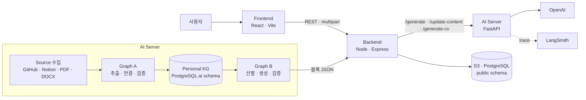
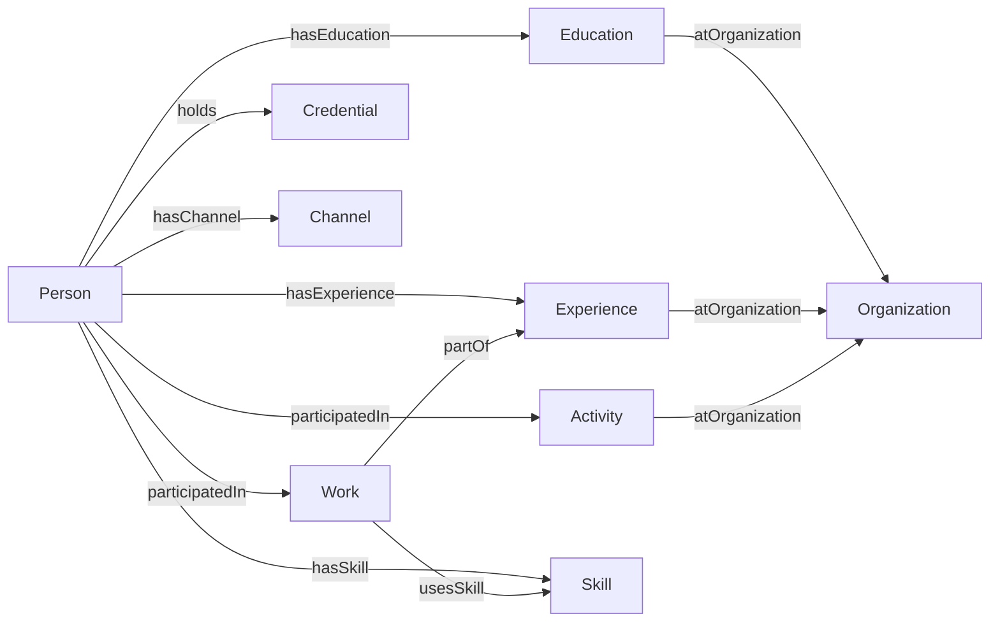

# APolo AI

[]()
[]()
[]()
[]()

> **APolo (Personal Online Link Organizer)** — 온톨로지 기반 온라인 명함 웹사이트의 AI 서비스

📑 [발표자료 (PDF)](https://drive.google.com/file/d/12nr3GqoO5BXNRbhyx28RbISpmGPAfvhq/view?usp=sharing)

🔗 [Backend 저장소 (apolo-server)](https://github.com/APolo-SMWU/apolo-server)

## Description

개인의 활동 기록은 GitHub · Notion · 블로그에 흩어져 있고, 명함·포트폴리오·CV처럼 목적이 바뀔 때마다 같은 경험을 다시 정리해야 합니다.
APolo는 흩어진 정보를 **개인 지식 그래프(Personal Knowledge Graph)** 하나로 모으고, 그 그래프에서 필요한 형태의 결과물을 만들어 냅니다.

이 저장소는 APolo의 AI 서버입니다. GitHub, Public Notion Page, 첨부 문서(PDF·DOCX), 사용자 프로필을 수집해 Personal Ontology 기반 KG로 구조화하고, KG에서 포트폴리오·CV 콘텐츠를 생성합니다.

| 기존 방식 | APolo |
|---|---|
| GitHub · Notion · SNS에 정보가 따로 흩어져 있음 | 개인 지식 그래프 하나로 정보를 통합 |
| 같은 경험을 문서마다 다시 작성 | 한 번의 입력으로 명함 · 포트폴리오 · CV를 함께 생성 |
| 정보가 바뀌면 각 문서를 일일이 수정 | 버튼 하나로 한 번에 갱신하고 출처 · 근거까지 연결 |

MVP User: 컴퓨터공학 관련 대학생 · 교수 · 현직자

## Main Feature

### 소스 수집
- GitHub 프로필·저장소, Public Notion Page, 첨부 PDF·DOCX를 수집해 Source · Snapshot으로 저장
- 내용 해시로 변경 여부를 판단해, 바뀐 소스만 다시 처리

### Graph A — 지식 그래프 구축
- LLM으로 소스에서 사실 후보를 추출하고 온톨로지 규칙으로 검증
- 같은 대상(프로젝트·기관·기술 등)을 하나의 Entity로 연결·병합해 KG에 저장
- 모든 Fact에 Source · Evidence를 함께 보존해 출처를 추적

### Graph B — 콘텐츠 생성
- 요구사항에 맞는 정보를 KG에서 선별해 포트폴리오 블록(소개 · 학력 · 경력 · 프로젝트 · 스킬 등) 생성
- 근거 · 형식 검증을 거쳐 Backend가 바로 저장할 수 있는 JSON으로 반환
- 같은 KG에서 CV 콘텐츠를 별도 API로 생성

### 콘텐츠 갱신 (UPDATE CONTENT)
- 원본 소스를 다시 수집해 변경분만 KG에 반영(수정 · 삭제)
- 바뀐 KG로 콘텐츠를 다시 생성

## System Architecture



- Frontend는 AI 서버를 직접 호출하지 않습니다. Backend가 AI 결과를 검증하고 최종 콘텐츠를 저장합니다.
- AI와 Backend는 같은 PostgreSQL을 쓰되, AI는 `ai` 스키마, Backend는 `public` 스키마를 사용합니다.

## Knowledge Graph

Personal Ontology v2.1 — 9개 클래스와 9개 관계로 사용자 정보를 표현합니다.

| 클래스 | 의미 |
|---|---|
| `Person` | 사용자 본인 |
| `Education` | 학력 |
| `Experience` | 경력 |
| `Activity` | 활동 |
| `Work` | 프로젝트 · 결과물 |
| `Credential` | 수상 · 자격 |
| `Skill` | 기술 · 역량 |
| `Organization` | 학교 · 회사 · 기관 |
| `Channel` | 이메일 · GitHub 등 연락 채널 |



**근거 레이어(Provenance):** 각 Fact마다 Source · Evidence를 함께 보존합니다. "React 사용 가능"이라는 정보에서 나아가, 어떤 프로젝트에서 사용했는지와 그 근거까지 연결합니다.

## API

| Method | Path | 설명 |
|---|---|---|
| GET | `/health` | 상태 확인 |
| POST | `/generate` | 프로필 · 링크 · 첨부로 KG 구축 후 포트폴리오 콘텐츠 생성 |
| POST | `/update-content` | 소스 재수집 · 변경 반영 후 콘텐츠 갱신 |
| POST | `/generate-cv` | KG 기반 CV 콘텐츠 생성 |

모든 API는 Backend만 내부적으로 호출합니다.

## Getting Started

### 요구 사항
- Python 3.12 이상
- [uv](https://docs.astral.sh/uv/)
- PostgreSQL (`ai` 스키마 CREATE 권한)

### 설치 · 환경 변수
```bash
uv sync --locked
cp .env.example .env
```

`.env`에 DB 접속 정보(`AI_DB_*`), `OPENAI_API_KEY`를 입력합니다. `GITHUB_TOKEN`, LangSmith 설정은 선택입니다.
모델·타임아웃·동시 추출 수는 `APOLO_*`로 조정할 수 있습니다(선택).

### DB 초기화
처음 설치할 때 아래 순서로 실행합니다.

```bash
uv run python -m apolo.db.migrate 001
uv run python -m apolo.db.migrate 002
uv run python -m apolo.db.migrate 003
uv run python -m apolo.db.migrate 004
uv run python -m apolo.db.migrate 005
uv run python -m apolo.db.migrate 006
uv run python -m apolo.db.migrate 007
uv run python -m apolo.db.migrate 008
uv run python -m apolo.db.migrate 009
```

이미 쓰던 DB는 적용하지 않은 번호만 순서대로 실행합니다.

### 실행
```bash
uv run uvicorn apolo.api:app --reload
```

### 검사
```bash
uv run ruff check src
```

### 배포
`main`에 병합되면 GitHub Actions가 CI를 통과한 뒤 SSH로 AWS Lightsail 서버의 배포 스크립트를 실행합니다(Nginx · PM2).

## Project Structure

```
apolo-ai
├── src/apolo/
│   ├── api.py               # FastAPI 엔드포인트
│   ├── contracts/           # 요청 · 응답 · KG 데이터 계약 (Pydantic)
│   ├── ontology/            # Personal Ontology 클래스 · 관계 · 값 규칙
│   ├── seed/                # 프로필 → Seed KG 변환 · 검증 · 반영
│   ├── collectors/          # GitHub · Notion · PDF · DOCX 수집
│   ├── extraction/          # 사실 후보 추출 · 검증 · Entity 연결 · 병합
│   ├── graph_a/             # Graph A workflow (수집 → KG 구축)
│   ├── content_selection/   # KG에서 콘텐츠용 정보 선별
│   ├── graph_b/             # Graph B 생성 · 정규화 · 검증
│   ├── cv/                  # CV 콘텐츠 생성
│   ├── llm/                 # LLM 클라이언트 · 모델 설정
│   └── db/                  # 스키마 SQL · 마이그레이션 · 저장 · 조회
├── evals/                   # 평가 케이스 · LangSmith 연동
└── .github/workflows/       # CI · 자동 배포
```

## Tech Stack

| 구분 | 기술 |
|---|---|
| Language | Python 3.12 |
| API | FastAPI, Uvicorn, Pydantic |
| AI Workflow | OpenAI (gpt-6-luna), LangGraph (Graph A) |
| Monitoring | LangSmith |
| Database | PostgreSQL (psycopg) |
| Document | pdfplumber, python-docx |
| Deploy | AWS Lightsail, Nginx, PM2, GitHub Actions |
| Dev Tools | uv, Ruff, pytest |
